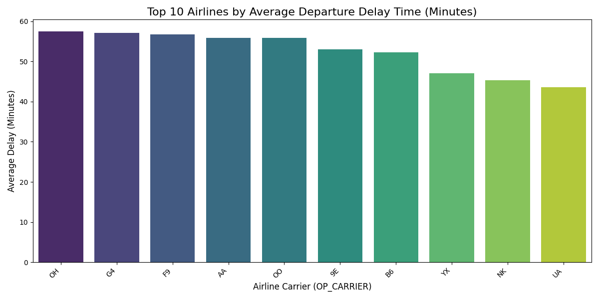
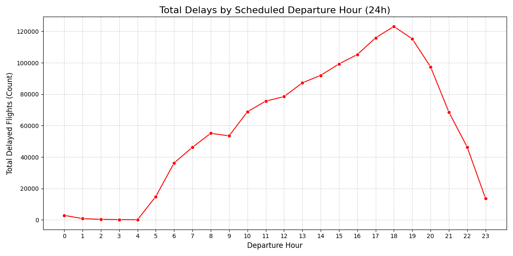
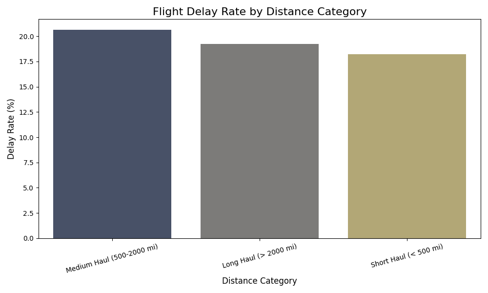
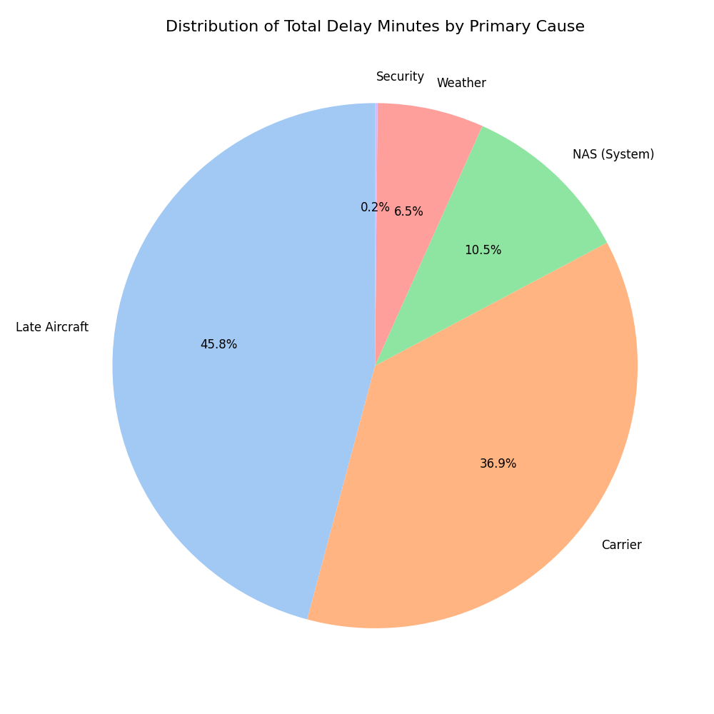

# Flight Delay Analysis & Predictive Machine Learning Pipeline

A distributed big-data engineering and machine learning system built on **Apache Spark**, **PySpark MLlib**, and **Docker** to process, analyze, and predict flight delays across 7+ million US flight records from 2024.

---

## Executive Summary

Flight delays pose complex operational and financial challenges for airlines, airports, and passengers. Predicting and analyzing delays requires processing high-volume, multi-dimensional operational data—including scheduled departure times, routing, carrier logistics, and aircraft turnarounds.

This project implements an end-to-end distributed data pipeline that:
1. Ingests and cleans large-scale 2024 flight records using a multi-node **Apache Spark** cluster.
2. Performs distributed aggregation to analyze delay patterns across carriers, departure hours, distance categories, and root delay causes.
3. Generates analytical visualizations from Spark-partitioned outputs to communicate operational findings.
4. Constructs a scalable **Spark MLlib** pipeline with categorical indexing, feature vectorization, feature scaling, and distributed hyperparameter tuning using 3-fold cross-validation.

---

## System Architecture

```text
                           Raw Flight Dataset (~7M+ Records)
                                          |
                                          v
                   +-----------------------------------------------+
                   |     Dockerized Apache Spark Cluster           |
                   |   (Master Node :7077 + Worker Node Network)   |
                   +-----------------------------------------------+
                                          |
                     +--------------------+--------------------+
                     |                                         |
                     v                                         v
         Distributed Analytics Engine                ML Feature Engineering
      (PySpark DataFrame Transformations)            - StringIndexer (Airports, Carriers)
      - Filter & Type Cast Schema                    - Origin Congestion Aggregation
      - Impute Missing Delays                        - VectorAssembler
      - Extract Temporal & Distance Attributes       - StandardScaler
                     |                                         |
                     v                                         v
          Distributed Aggregations                   Train/Test Split (80/20)
       Saved to Partitioned CSV Part-Files                     |
                     |                       +-----------------+-----------------+
                     v                       |                                   |
         Driver-Side Visualizations          v                                   v
        (Matplotlib & Seaborn Charts)  Logistic Regression             Random Forest Classifier
                                       Baseline (maxIter=100)          - ParamGridBuilder
                                             |                         - 3-Fold CrossValidator
                                             v                         - Parallelism Tuning
                                       Model Evaluation                          |
                                       (ROC-AUC & Accuracy)                      v
                                             |                         Best Model Selection &
                                             v                         Serialized Persistence
                                     Persisted Model Artifacts
```

---

## Technology Stack & Architectural Rationale

This project was intentionally designed using enterprise big-data technologies to demonstrate practical data engineering and distributed machine learning patterns.

| Technology | Role | Why This Technology Was Chosen (Interview Rationale) |
| :--- | :--- | :--- |
| **Apache Spark 3.3** | Distributed Processing Engine | **Overcoming Single-Node Limits:** The dataset spans 7+ million rows (~1+ GB raw CSV). Standard Pandas workflows load data entirely into RAM, risking Out-Of-Memory (OOM) errors and lacking parallelization. Spark utilizes distributed memory, resilient distributed datasets (RDDs/DataFrames), and the Catalyst query optimizer for parallel execution across cluster nodes. |
| **PySpark** | Distributed DataFrame API | **Ecosystem Bridge:** Allows combining Python's rich data science ecosystem with the high-performance distributed JVM runtime of Apache Spark. Uses lazy evaluation to optimize execution plans before materializing transformations. |
| **Spark MLlib** | Distributed Machine Learning | **Parallelized Model Training:** Unlike Scikit-Learn, which runs primarily on a single machine or uses local threading, Spark MLlib executes feature indexing, vectorization, and model training in a distributed fashion across the cluster. The `CrossValidator` evaluates hyperparameter grids concurrently across worker nodes. |
| **Docker & Docker Compose** | Infrastructure & Clustering | **Reproducible Architecture:** Standardizes the master-worker cluster topology (`spark-master` on port 8080/7077, `spark-worker`) over an isolated bridge network (`spark-net`). Mounted volumes (`./code` and `./data`) eliminate environment drift and enable reliable execution across any host machine without bare-metal Spark installations. |
| **Python 3** | Core Programming Language | **Data Engineering Standard:** Primary language for orchestrating data pipelines, model definitions, and custom Spark UDFs. |
| **Pandas, Matplotlib & Seaborn** | Post-Processing & Visualization | **Driver-Side Aggregation Pattern:** Plotting libraries cannot operate directly on distributed clusters. Spark was used to reduce millions of rows down to aggregated summary tables (`part-*.csv`), which were then read locally by Pandas to generate publication-quality figures. |

---

## Project Structure

```text
FlightDelayProject/
├── code/
│   ├── flight_analysis.py          # Distributed ETL, data cleaning, and 4 core analytical aggregations
│   ├── flight_prediction.py        # Spark MLlib pipeline (StringIndexer, StandardScaler, LR, Random Forest + CV)
│   ├── create_visuals.py           # Driver-side script to render high-res charts from Spark part-files
│   ├── sample_run.py               # Fast local verification script for development testing
│   ├── lr_model_for_demo_v2/       # Persisted Spark Logistic Regression model artifacts
│   └── rf_best_model/              # Persisted Spark Random Forest CrossValidator best-model pipeline
│
├── conf/
│   └── spark-defaults.conf         # Spark engine memory and runtime configuration
│
├── data/
│   ├── flight_data_2024.csv        # Raw flight dataset (~7M records, excluded from git)
│   └── results/                    # Distributed partition outputs (part-*.csv) generated by Spark
│       ├── top_carriers/
│       ├── hourly_delays/
│       ├── distance_rate/
│       └── delay_cause_breakdown/
│
├── visuals/
│   ├── 1_Top_Delayed_Carriers.png  # Visual 1: Average delay minutes by top delayed airlines
│   ├── 2_Hourly_Delay_Trend.png    # Visual 2: 24-hour departure hour delay count progression
│   ├── 3_Distance_Delay_Rate.png   # Visual 3: Flight delay proportion across flight distance categories
│   └── 4_Primary_Delay_Causes.png  # Visual 4: Share of total delay minutes attributed to primary causes
│
├── docker-compose.yml              # Cluster definition: Spark Master + Spark Worker network
└── README.md
```

---

## Data Engineering & Preprocessing Pipeline

### 1. Ingestion and Schema Enforcement
Raw CSV data is loaded into Spark using `inferSchema=True` and `header=True`, followed by explicit casting of critical numeric fields (`DEP_DELAY`, `ARR_DELAY`, `DISTANCE`, `crs_dep_time`) to `DoubleType` and `IntegerType`.

### 2. Data Cleaning & Leakage Prevention
* Non-predictive or high-leakage identifiers are dropped (`FL_NUM`, `TAIL_NUM`, `CANCELLATION_CODE`).
* Null delays are imputed to `0` based on the operational premise that unflagged flights operated on schedule.
* Null records in critical categorical join keys (`origin`, `dest`, `op_unique_carrier`) are removed.

### 3. FAA Industry Standard Target Variable
In line with the Federal Aviation Administration (FAA) and Bureau of Transportation Statistics (BTS) standard, a flight is classified as delayed if departure delay exceeds **15 minutes**:

$$\text{IS\_DELAYED} = \begin{cases} 1 & \text{if } \text{DEP\_DELAY} > 15 \\ 0 & \text{otherwise} \end{cases}$$

### 4. Distributed Feature Engineering
* **Temporal Attributes:** Departure hour (`DEP_HOUR`) and month (`FL_MONTH`) extracted from departure timestamps. A custom Spark User Defined Function (UDF) parses scheduled departure times (`CRS_DEP_TIME`) into 24-hour integers.
* **Airport Congestion Metric (`Avg_Delay_Origin`):** Distributed group-by and aggregation computing the historical average delay per origin airport, subsequently joined back to the primary DataFrame.
* **Distance Bucketing:** Categorization into Short Haul (< 500 mi), Medium Haul (500–2,000 mi), and Long Haul (> 2,000 mi).

---

## Analytical Visualizations & Key Insights

The following visualizations were produced by running distributed Spark aggregations over the complete 2024 dataset, saving partitioned results, and rendering publication-ready figures using Seaborn and Matplotlib.

---

### Visual 1: Top 10 Airlines by Average Departure Delay Time



* **What it displays:** Compares the top 10 airline carriers (`op_unique_carrier`) ranked by their average departure delay in minutes, restricted to flights that experienced delays.
* **Key Findings:**
  * Regional and budget carriers (such as PSA Airlines `OH`, Allegiant Air `G4`, and Frontier Airlines `F9`) exhibit the highest average delays, each averaging over **56 to 57 minutes** per delayed flight.
  * Major legacy carriers like American Airlines (`AA`) maintain high total volumes of delayed flights (over 400,000 delayed flights in the sample) with an average delay of **55.9 minutes**.
* **Interview / Operational Takeaway:** Carrier-specific turn times, tight aircraft utilization schedules, and secondary-hub congestion heavily impact delay severity. Regional feeders operating regional jets often absorb ground delays to prioritize main-line flight slots.

---

### Visual 2: Hourly Delay Trend Across 24 Hours



* **What it displays:** Tracks the total number of delayed flights as a function of the scheduled departure hour (00:00 to 23:00).
* **Key Findings:**
  * Delays are minimal between **03:00 and 06:00** (under 1,000 flights), when airports initiate the first bank of daily departures with fresh aircraft and rested crews.
  * Starting at 07:00, delays surge monotonically, peaking sharply between **17:00 and 20:00** (over 80,000+ delayed flights per hour).
  * Late evening hours (21:00 to 23:00) experience a downward slope in total flights, but delay severity remains high.
* **Interview / Operational Takeaway:** Illustrates the phenomenon of **cascading schedule buffers**. When an inbound aircraft arrives 20 minutes late in the morning, that delay compounds across subsequent legs due to gate congestion, maintenance holds, and crew duty limits.

---

### Visual 3: Flight Delay Rate by Distance Category



* **What it displays:** Evaluates the percentage delay rate across three operational distance categories: Short Haul (< 500 mi), Medium Haul (500–2,000 mi), and Long Haul (> 2,000 mi).
* **Key Findings:**
  * **Medium Haul (500–2,000 mi):** Highest delay rate at **20.66%** (~873,000 delayed out of 4.22M flights).
  * **Long Haul (> 2,000 mi):** Second highest at **19.23%** (~83,700 delayed out of 435,000 flights).
  * **Short Haul (< 500 mi):** Lowest delay rate at **18.21%** (~440,000 delayed out of 2.42M flights).
* **Interview / Operational Takeaway:** Medium-haul flights make up the majority of US domestic network flying and frequently connect congested hub-to-hub routes subject to National Airspace System (NAS) ground delay programs. Short-haul flights have shorter flight times and flexible gate assignments, while long-haul flights receive priority en-route spacing from Air Traffic Control.

---

### Visual 4: Primary Delay Cause Breakdown



* **What it displays:** A breakdown of total accumulated delay minutes categorized by primary delay cause: Late Aircraft, Carrier, National Airspace System (NAS), Extreme Weather, and Security.
* **Key Findings:**
  * **Late Aircraft Delay (45.8% / 38.7M minutes):** The single largest contributor. The aircraft arriving late from its previous segment is responsible for nearly half of all delay duration.
  * **Carrier Delay (36.9% / 31.2M minutes):** Internal airline operational factors (aircraft maintenance, baggage handling, fueling, crew changes).
  * **NAS / Air Traffic Control (10.5% / 8.9M minutes):** Airspace volume congestion and airport ground delays.
  * **Weather (6.5% / 5.5M minutes):** Direct extreme meteorological events preventing safe flight.
  * **Security (<0.2% / ~131K minutes):** Terminal rescreenings and security incidents.
* **Interview / Operational Takeaway:** Contrary to popular belief that "weather causes most flight delays," extreme weather directly accounts for only 6.5% of total delay duration. Over **82% of all delay time** stems from internal airline operations and downstream aircraft rotation (Late Aircraft + Carrier).

---

## Machine Learning Pipeline & Model Evaluation

The prediction pipeline models whether a scheduled flight will be delayed (`IS_DELAYED` = 1) using **PySpark MLlib**.

### 1. Feature Transformation Pipeline
1. **`StringIndexer`:** Encodes nominal variables (`origin`, `dest`, `op_unique_carrier`) into indexed numeric representations with `handleInvalid="keep"`.
2. **`VectorAssembler`:** Combines the indexed categorical features with continuous numerical features (`DISTANCE`, `DEP_HOUR`, `FL_MONTH`, `Avg_Delay_Origin`) into a single dense feature vector `features_unscaled`.
3. **`StandardScaler`:** Normalizes features with unit standard deviation (`withStd=True`), outputting the final `features` vector for numerical stability during gradient updates.

### 2. Train / Test Split
Data is split **80% training** and **20% testing** using a deterministic random seed (`seed=42`) across distributed partitions to maintain evaluation integrity.

### 3. Model Architecture & Distributed Hyperparameter Tuning
* **Baseline Classifier (Logistic Regression):**
  * Estimator: `LogisticRegression(featuresCol='features', labelCol='IS_DELAYED', maxIter=100)`.
  * Evaluates baseline linear separability with low computational overhead across the cluster.
* **Non-Linear Classifier (Random Forest with 3-Fold Cross-Validation):**
  * Estimator: `RandomForestClassifier(seed=42)`.
  * Hyperparameter Search Grid via `ParamGridBuilder`:
    * `numTrees`: `[10, 20]`
    * `maxDepth`: `[5, 10]`
  * Cross-Validation: Evaluated using `CrossValidator(numFolds=3, parallelism=2)` using `BinaryClassificationEvaluator(metricName="areaUnderROC")`.
  * Distributes 12 total model training jobs (4 configurations $\times$ 3 folds) across worker nodes concurrently.

### 4. Model Persistence
Fitted models and pipeline stages are serialized directly to disk (`/code/lr_model_for_demo_v2` and `/code/rf_best_model`) for downstream serving, batch inference, or demonstration.

---

## Environment Setup & Execution Guide

### Prerequisites
* Docker Engine (20.10+)
* Docker Compose (v2.0+)
* Python 3.8+ (for local visualization rendering)

### 1. Dataset Placement
Download or place the 2024 flight dataset at:
```text
data/flight_data_2024.csv
```
*(The raw dataset is excluded from version control due to its ~1 GB file size).*

### 2. Launch the Spark Cluster
Start the Spark master and worker containers in detached mode:
```bash
docker compose up -d
```

Verify cluster status:
```bash
docker compose ps
```
The Spark Master Web UI will be accessible locally at `http://localhost:8080`.

### 3. Execute Distributed Data Processing & Analysis
Run the PySpark analysis job inside the cluster to process raw data and export summary part-files:
```bash
docker compose exec spark-master /spark/bin/spark-submit \
  --master spark://spark-master:7077 \
  /code/flight_analysis.py
```

### 4. Render Analytical Visualizations
Generate the charts from Spark's partitioned output:
```bash
python3 code/create_visuals.py
```
Generated figures will be saved directly into `visuals/`.

### 5. Train & Evaluate the Machine Learning Pipeline
Submit the distributed ML training and cross-validation job:
```bash
docker compose exec spark-master /spark/bin/spark-submit \
  --master spark://spark-master:7077 \
  /code/flight_prediction.py
```

---

## Key Interview Discussion Points

When discussing this project in engineering and data science interviews:

1. **Why Spark instead of single-node libraries like Pandas or Polars?**
   While modern tools like Polars handle out-of-core memory on single machines, Spark provides true distributed scale-out capability. As flight data scales from 1 year (~7M rows) to 10 years (~70M+ rows), Spark scales horizontally by adding worker nodes rather than vertically upgrading expensive server RAM.
2. **How is data leakage avoided?**
   Features derived from the flight outcome (e.g., `ARR_DELAY`, actual departure timestamps, cancellation reasons) are strictly excluded from the prediction feature vector. Only scheduled features (`CRS_DEP_TIME`, `DISTANCE`, `FL_MONTH`, historical airport delay averages) available prior to flight departure are utilized.
3. **How does distributed CrossValidator work in Spark?**
   Spark constructs an RDD of model configurations from `ParamGridBuilder`. With `parallelism=2`, Spark submits multiple training tasks simultaneously across available worker cores, drastically reducing grid-search latency compared to sequential Scikit-Learn evaluation.
4. **Driver vs. Worker Memory Management:**
   Heavy computation (filtering, schema transformations, feature scaling, aggregation) occurs strictly on worker nodes. The driver program only receives final aggregated metric tables via `part-*.csv` outputs, keeping driver memory overhead low.

---

## Author

**Tanay Bhomia**  
*Distributed Systems, Big Data Engineering & Applied Machine Learning*
